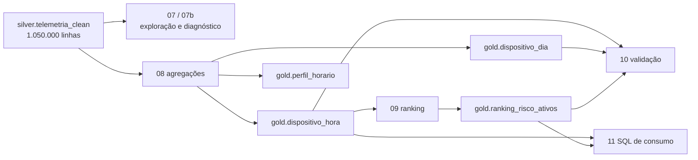

# Fase 3: Camada Gold

Projeto vitrine de engenharia de dados: telemetria de transformadores de distribuição em um lakehouse no Databricks (Delta Lake, arquitetura medalhão).

Esta fase constrói a **camada Gold** a partir da Silver e entrega tabelas de consumo e um ranking de ativos. O resultado central é um achado de método: **neste dataset, nenhum sinal separa os 50 transformadores além do acaso**, e o ranking foi desenhado para mostrar isso em vez de produzir um score com falsa precisão.

| | |
|---|---|
| Plataforma | Databricks Free Edition (Delta Lake, Spark SQL, PySpark) |
| Catálogo / schema | `project_lakehouse_telemetria_ele.gold` |
| Entrada | `project_lakehouse_telemetria_ele.silver.telemetria_clean` (1.050.000 linhas) |
| Cobertura | 50 transformadores (`TRF-001` a `TRF-050`), 7 dias (2026-10-01 a 2026-10-07), 168 horas por ativo |
| Status | Concluída e validada em 2026-11-09 |

## Sumário

1. [Arquitetura](#arquitetura)
2. [Tabelas Gold](#tabelas-gold)
3. [Notebooks](#notebooks)
4. [Regras de negócio das métricas](#regras-de-negócio-das-métricas)
5. [Investigação do sinal de alarme](#investigação-do-sinal-de-alarme)
6. [Diagnóstico: os sinais separam os ativos?](#diagnóstico-os-sinais-separam-os-ativos)
7. [Ranking com controle estatístico](#ranking-com-controle-estatístico)
8. [Validação](#validação)
9. [Consultas de consumo](#consultas-de-consumo)
10. [Como reproduzir](#como-reproduzir)
11. [Aprendizados](#aprendizados)
12. [Limitações e próximos passos](#limitações-e-próximos-passos)

## Arquitetura

A Gold só lê a Silver. Os notebooks 07 e 07b são analíticos e não escrevem tabelas.

## Tabelas Gold

| Tabela | Grão | Linhas | Estratégia de escrita |
|---|---|---|---|
| `gold.dispositivo_hora` | `device_id` × hora | 8.400 (50 × 168) | `MERGE` pela chave `(device_id, hora_ts)` |
| `gold.dispositivo_dia` | `device_id` × dia | 350 (50 × 7) | `MERGE` pela chave `(device_id, data_evento)` |
| `gold.perfil_horario` | hora do dia (0 a 23) | 24 | `CREATE OR REPLACE` |
| `gold.ranking_risco_ativos` | `device_id` | 50 | `CREATE OR REPLACE` (snapshot recalculado) |

### Colunas

**`dispositivo_hora` e `dispositivo_dia`** (a diária troca `hora_ts` por `data_evento`)

| Coluna | Descrição |
|---|---|
| `device_id`, `hora_ts` / `data_evento` | Chave de grão |
| `leituras` | Total de leituras no grão |
| `leituras_validas` | Leituras sem pico e sem sentinela |
| `temp_media`, `temp_max`, `temp_min` | Temperatura (°C), só leituras válidas |
| `tensao_media` | Tensão (V), só leituras válidas |
| `corrente_media` | Corrente (A), só leituras válidas |
| `qtd_picos` | Leituras com `temp_pico` |
| `qtd_alarmes` | Leituras com `alarme = 'SOBRETEMP'` |
| `qtd_tensao_ausente` | Leituras com tensão ausente |
| `qtd_corrente_sentinela` | Leituras com corrente sentinela |

**`perfil_horario`**: `hora_do_dia`, `leituras`, `temp_media_todas`, `temp_media_filtrada`, `qtd_picos`, `qtd_alarmes`.

**`ranking_risco_ativos`**: `device_id`, `posicao`, `z_max`, `nivel`, `sinal_dominante`, `z_picos`, `z_tensao`, `z_sentinela`, `posicao_so_picos`, `delta_posicao`, `leituras`, contagens por sinal, percentuais por sinal e `pct_picos_ic95_min` / `pct_picos_ic95_max`.

## Notebooks

| Notebook | Função |
|---|---|
| `07_exploracao_alarme` | Perfil da coluna `alarme`: valores, nulos, taxa por dia, hora e dispositivo; cruzamento com as três flags |
| `07b_diagnostico_sinais` | Compara, para seis sinais, a dispersão observada entre os ativos com a esperada só por amostragem |
| `08_gold_agregacoes` | Cria `dispositivo_hora`, `dispositivo_dia` e `perfil_horario` |
| `09_gold_ranking_risco` | Calcula z-scores por sinal, limite corrigido e ranking |
| `10_validacao_gold` | Conciliação com a Silver, chaves, ranking, sanidade estatística e idempotência |
| `11_sql_consumo` | Consultas para manutenção, operação e análise |

Ordem de execução: 07, 07b, 08, 09, 10, 11. Os notebooks 08 e 09 podem ser reexecutados sem alterar resultados.

## Regras de negócio das métricas

- **Métricas de comportamento** (médias, máximos e mínimos de temperatura, tensão e corrente) usam só leituras **sem sentinela e sem pico**, para que valores de falha não contaminem a média.
- **Contagens de problemas** (picos, alarmes, tensão ausente, corrente sentinela) usam **todas** as leituras, para que a Gold reconcilie exatamente com a Silver.
- **Idempotência:** as tabelas com `MERGE` usam a chave de grão; reexecutar o notebook atualiza as mesmas linhas em vez de duplicar.

## Investigação do sinal de alarme

A coluna `alarme` não tem nulos e só tem dois valores:

| Valor | Linhas | % |
|---|---|---|
| `OK` | 1.046.850 | 99,7 |
| `SOBRETEMP` | 3.150 | 0,3 |

Cruzando com `temp_pico`, as únicas combinações existentes são alarme = 0 com pico = 0 (1.046.850) e alarme = 1 com pico = 1 (3.150). **O alarme é idêntico ao pico de temperatura**: não é um sinal independente e não deve receber peso próprio. Também não há relação com tensão ausente (lift 0,92) nem com corrente sentinela (lift 1,11).

Outros achados da exploração:
- Exatamente 450 alarmes por dia, nos 7 dias (150.000 leituras por dia).
- Alarmes por hora entre 108 e 150, sem concentração nas horas quentes.
- Taxa de alarme por dispositivo entre 0,229% e 0,381%, com média 0,300% e coeficiente de variação de 0,119.

## Diagnóstico: os sinais separam os ativos?

Antes de montar um score, o `07b` testa se cada sinal tem poder de separação. Para cada sinal, compara o desvio **observado** entre os 50 ativos com o desvio **esperado só por amostragem** (erro padrão):

`razão = desvio_observado / desvio_esperado_por_acaso`

Razão perto de 1 significa que a diferença entre ativos é compatível com ruído. Os sinais de comportamento usam o resíduo contra a média da frota na mesma hora do dia, para remover o ciclo diário de temperatura.

| Sinal | Desvio observado | Desvio esperado | Razão | Leitura |
|---|---|---|---|---|
| Tensão ausente (taxa) | 0,00076 | 0,00069 | 1,11 | ruído |
| Tensão média | 0,01432 | 0,01392 | 1,03 | ruído |
| Temperatura residual por hora | 0,00803 | 0,00829 | 0,97 | ruído |
| Corrente média | 0,05800 | 0,05962 | 0,97 | ruído |
| Picos / alarme (taxa) | 0,00036 | 0,00038 | 0,95 | ruído |
| Corrente sentinela (taxa) | 0,00029 | 0,00031 | 0,92 | ruído |

Nenhum sinal passa do critério de "sinal real" (razão acima de 2). As falhas e o comportamento foram gerados de forma uniforme entre os ativos.

## Ranking com controle estatístico

### Por que não um score ponderado

A proposta inicial era um score composto: taxas normalizadas com `PERCENT_RANK()` e combinadas por pesos. O diagnóstico mostrou que isso ordenaria ruído. O `PERCENT_RANK` converte qualquer diferença, mesmo aleatória, em uma posição de 0 a 1, o que produz um ranking aparentemente preciso e sem base estatística. Além disso, alarme e picos contariam o mesmo evento duas vezes.

### O que foi feito

Cada ativo recebe um **z-score por sinal** contra a taxa da frota:

`z = (taxa_do_ativo − taxa_da_frota) / √(taxa_da_frota × (1 − taxa_da_frota) / n)`

Sinais: sobretemperatura (`temp_pico`, equivalente ao alarme), tensão ausente e corrente sentinela. Só excesso de falhas conta como pior (z positivo).

- **Posição:** por `z_max` (maior z entre os três sinais), desempate por `device_id`.
- **Limite de atenção:** `z ≥ 3,403`. É unilateral, com correção de Bonferroni para 150 testes (50 ativos × 3 sinais) e alfa global de 0,05. Com esse limite, a chance de qualquer falso positivo na frota inteira fica em torno de 5%.
- **Níveis:** `atenção` (z_max acima do limite) e `dentro do esperado`.
- **Intervalo de confiança:** `pct_picos_ic95_min` e `pct_picos_ic95_max` são o IC95% da taxa de picos do próprio ativo, **sem correção para múltiplos testes**. Entre 50 ativos, 2 a 3 ficam fora da taxa da frota só por acaso, por isso a decisão usa o `z_limite`.

### Resultado

Nenhum ativo ultrapassa o limite.

| Posição | Ativo | z_max | Sinal dominante | z picos | z tensão | z sentinela |
|---|---|---|---|---|---|---|
| 1 | TRF-027 | 2,635 | tensão ausente | 2,145 | 2,635 | 0,927 |
| 2 | TRF-043 | 2,219 | tensão ausente | 0,252 | 2,219 | 0,000 |
| 3 | TRF-040 | 2,162 | corrente sentinela | 1,009 | 0,139 | 2,162 |
| 4 | TRF-036 | 2,081 | tensão ausente | 1,640 | 2,081 | 1,236 |
| 5 | TRF-046 | 1,803 | tensão ausente | 0,505 | 1,803 | 0,000 |

Comportamento dos z-scores na frota:

| Sinal | Média dos z | Desvio dos z | z máximo |
|---|---|---|---|
| Sobretemperatura | 0,000 | 0,948 | 2,145 |
| Tensão ausente | 0,000 | 1,110 | 2,635 |
| Corrente sentinela | 0,000 | 0,925 | 2,162 |

Sob ruído puro, a média dos z é 0 e o desvio é 1; é exatamente o que aparece. O z máximo observado (2,635) é o valor esperado para o maior de 150 sorteios de uma normal padrão (em torno de 2,6 a 2,7).

O TRF-027 liderava o ranking só por picos na Fase 2, com 80 picos contra média de 63. Nesta fase, o z dele para sobretemperatura é 2,145: o extremo esperado entre 50 ativos, não uma anomalia.

## Validação

O notebook `10_validacao_gold` usa `assert`: qualquer divergência interrompe a execução.

**Conciliação com a Silver (10 de 10 conferências OK)**

| Métrica | Silver | `dispositivo_hora` | `dispositivo_dia` |
|---|---|---|---|
| Leituras | 1.050.000 | 1.050.000 | 1.050.000 |
| Picos | 3.150 | 3.150 | 3.150 |
| Alarmes | 3.150 | 3.150 | 3.150 |
| Tensão ausente | 10.500 | 10.500 | 10.500 |
| Corrente sentinela | 2.100 | 2.100 | 2.100 |

**Integridade**
- `dispositivo_hora`: 8.400 linhas, sem chave repetida (máximo teórico 50 × 168).
- `dispositivo_dia`: 350 linhas, sem chave repetida.
- `perfil_horario`: 24 horas distintas.
- `ranking_risco_ativos`: 50 ativos, posições únicas de 1 a 50, nenhum z nulo ou NaN, `nivel` coerente com o limite.

**Idempotência:** o notebook reexecuta 08 e 09 e compara as contagens antes e depois.

| Tabela | Antes | Depois |
|---|---|---|
| `dispositivo_hora` | 8.400 | 8.400 |
| `dispositivo_dia` | 350 | 350 |
| `perfil_horario` | 24 | 24 |
| `ranking_risco_ativos` | 50 | 50 |
| Soma de leituras | 1.050.000 | 1.050.000 |

## Consultas de consumo

O notebook `11_sql_consumo` traz consultas prontas:

1. Top 10 do ranking com z por sinal e IC95% da taxa de picos.
2. Picos por dia dos 5 primeiros do ranking. Esperado de cerca de 9 por dia (3.000 leituras × 0,3%); observado entre 5 e 16, sem tendência.
3. Horários com mais alarmes e picos. Entre 108 e 150 por hora (esperado cerca de 131); os máximos (150) ocorrem às 15h e às 17h, não ao meio-dia.
4. Ativos acima do limite estatístico. Retorna **zero linhas**, que é um resultado válido.
5. Perfil horário da temperatura.

### Perfil horário da temperatura

A temperatura média segue um ciclo diário suave: 52,68 °C às 0h e 67,68 °C às 12h (mesmo valor da Fase 1, 52,7 e 67,7). A média filtrada (sem picos e sem sentinela) fica de 0,15 a 0,20 °C abaixo da média com todas as leituras, em todas as horas, efeito dos 3.150 picos. Os picos, porém, **não acompanham o ciclo térmico**: ficam entre 108 e 150 por hora, sem concentração nas horas quentes, o que indica que foram injetados de forma independente da temperatura.

## Como reproduzir

Pré-requisitos: Fases 1 e 2 executadas, com `silver.telemetria_clean` populada.

1. Importe a pasta `Fase3-camada_gold` no workspace (Git folder do Databricks).
2. Confira os nomes de colunas da Silver com o `DESCRIBE` do notebook 07 (`device_id`, `event_ts`, `temperatura_c`, `tensao_v`, `corrente_a`, `alarme`, `temp_pico`, `tensao_ausente`, `corrente_sentinela`, `data_evento`).
3. Execute na ordem: `07`, `07b`, `08`, `09`, `10`, `11`.
4. O `10` reexecuta `08` e `09` com `dbutils.notebook.run`; os notebooks devem estar na mesma pasta.

## Aprendizados

- **Testar o poder de separação dos sinais antes de montar um score.** A razão entre desvio observado e esperado resolve isso em uma consulta.
- **`PERCENT_RANK` sobre ruído produz um ranking aparentemente preciso e sem base.** Z-score com limite corrigido para múltiplos testes diz quando não há nada a priorizar.
- **Resultado nulo é válido.** Zero ativos acima do limite é uma resposta, e foi documentada como tal.
- **Valor de texto não reconhecido vira 0 em silêncio.** A primeira versão da regra de alarme procurava `'1'` ou `'true'`, mas os valores reais eram `OK` e `SOBRETEMP`; todas as taxas saíram 0 sem erro. Conferir os valores reais antes de definir a expressão.
- **Intervalo de confiança sem correção engana em escala.** Entre 50 ativos, 2 a 3 ficam fora da frota por acaso; a decisão deve usar o limite corrigido.
- **Redundância entre sinais precisa ser checada.** Alarme e pico eram o mesmo evento; um score com os dois contaria duas vezes.

## Limitações e próximos passos

- **Dataset sintético:** falhas e comportamento são uniformes entre os ativos, por isso o ranking não encontra anomalias. Os resultados mostram que o método não gera falsos positivos; ainda falta mostrar que ele detecta ativos realmente anômalos.
- **Janela curta:** 7 dias limitam análise de tendência e sazonalidade.
- **Independência das leituras:** a razão observado/esperado supõe leituras independentes. Com autocorrelação temporal, o desvio esperado real é um pouco maior e a razão é levemente otimista.
- **Próximo passo possível:** injetar degradação em 3 a 5 transformadores no `01_gerar_dados` (deriva de temperatura ou excesso de picos) e verificar que `07b` e `09` os detectam, o que valida o método de ponta a ponta. Outras opções: orquestração com Workflows e uma camada de consumo (dashboard).
