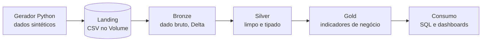

# Telemetria Lakehouse: monitoramento de ativos elétricos

Pipeline de engenharia de dados, construído em público no **Databricks**, que transforma leituras brutas de sensores de transformadores em informação confiável para decisões de manutenção.

O projeto une duas áreas: **engenharia de dados** (pós-graduação em Engenharia de Dados, PUC Minas) e **engenharia elétrica** (graduação em Engenharia Elétrica, UNISUAM). Cada fase é desenvolvida, documentada e publicada separadamente.

## O problema

Transformadores geram leituras contínuas de tensão, corrente e temperatura. Em campo, esses dados chegam com falhas: sensores que não respondem (nulos), valores inválidos usados como marcador (sentinelas), retransmissões (duplicados) e picos de temperatura. Sem tratamento, qualquer indicador de manutenção construído sobre eles é pouco confiável.

**Pergunta do projeto:** como transformar esse dado bruto e imperfeito em tabelas confiáveis que apoiem decisões de manutenção?

## Arquitetura

O projeto segue a arquitetura **Medallion**, em que o dado evolui por camadas de qualidade crescente.



| Camada | Papel | Regra principal |
|---|---|---|
| **Landing** | Arquivos CSV como chegam da fonte | Imutável |
| **Bronze** | Cópia fiel do dado bruto em Delta | Não se limpa nada |
| **Silver** | Dado tipado, deduplicado e validado | Qualidade e consistência |
| **Gold** | Tabelas e indicadores para o negócio | Pronto para consumo |

## Stack

- **Plataforma:** Databricks Free Edition (serverless)
- **Governança:** Unity Catalog (catálogo, schemas e volumes)
- **Armazenamento:** Delta Lake
- **Processamento:** PySpark e SQL
- **Ingestão:** Auto Loader
- **Versionamento:** Git folder do Databricks integrado ao GitHub

## Fases do projeto

| Fase | Pasta | Foco | Status |
|---|---|---|---|
| 1 | [`Fase1-camada_bronze`](./Fase1-camada_bronze) | Geração de dados, ingestão incremental e diagnóstico de qualidade | ✅ Concluída |
| 2 | [`Fase2-camada_silver`](./Fase2-camada_silver) | Tipagem, deduplicação, tratamento de nulos e sentinelas, SQL avançado | ✅ Concluída |
| 3 | `Fase3-camada_gold` | Modelagem para negócio, indicadores e visão por ativo | ⬜ Planejada |
| 4 | `Fase4-orquestracao_qualidade` | Workflows automatizados e testes de Data Quality | ⬜ Planejada |
| 5 | `Fase5-streaming_observabilidade` | Dados em tempo quase real e monitoramento do pipeline | ⬜ Planejada |
| 6 | `Fase6-polimento` | Documentação final, dashboard e apresentação do case | ⬜ Planejada |

### Fase 1: Camada Bronze ✅
Geração de um dataset sintético (7 dias, 50 transformadores, mais de 1 milhão de linhas) com falhas injetadas de propósito. Ingestão incremental e idempotente com Auto Loader em tabela Delta, preservando o dado exatamente como chegou, com rastreio de arquivo de origem e hora de ingestão. Diagnóstico das falhas de qualidade que a Silver vai resolver.

### Fase 2: Camada Silver ✅
Conversão de tipos (timestamp e numéricos), remoção de duplicados por linha completa, tratamento de nulos e do valor sentinela, sinalização de picos de temperatura e regras de qualidade. Uso de funções de janela em SQL.

### Fase 3: Camada Gold
Tabelas analíticas para o negócio: perfil de carga por transformador, indicadores de temperatura e alarmes, e ranking de ativos que pedem atenção.

### Fase 4: Orquestração e Data Quality
Pipeline encadeado e agendado com Workflows, com testes automatizados de qualidade entre as camadas.

### Fase 5: Streaming e observabilidade
Ingestão em fluxo contínuo e monitoramento do pipeline (volume, atrasos e falhas).

### Fase 6: Polimento
Documentação final, dashboard e apresentação do case de ponta a ponta.

## Estrutura no Databricks

```
project_lakehouse_telemetria_ele      (catálogo)
├── bronze                            (schema)
│   └── landing                       (volume com os CSVs)
├── silver
└── gold
```


## Autor

**Ramon Sieia**: bombeiro de aeródromo chefe, engenheiro eletricista e pós-graduado em engenharia de dados, em transição de carreira para dados e energia.

- LinkedIn: `https://www.linkedin.com/in/ramon-sieia-medeiros/`
